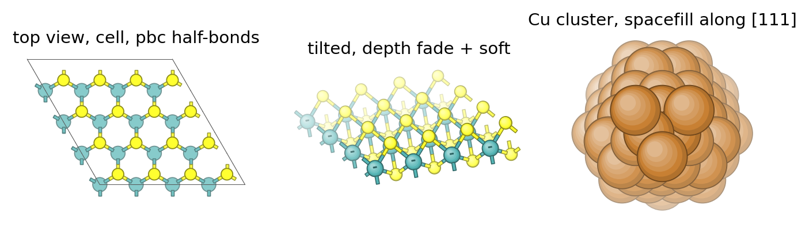

# inkatoms

Elegant ball-and-stick drawings of atomic structures, drawn natively in
matplotlib. The output is a vector drawing, so it stays sharp in a PDF, can be
edited in Illustrator/Inkscape, and sits in a figure panel next to your plots
with the same fonts and axes.

- **Depth cueing**: atoms further back fade towards the page and shrink a
  little, so a flat orthographic view still reads in 3D.
- **Correct overlaps**: atoms, half-bonds and cell edges are depth-sorted
  together into one collection, so a bond passes in front of one atom and
  behind the next.
- **Highlights**: pick out the atoms that matter; they are never faded.
- **Standard colour schemes**: Jmol, classic CPK, greyscale and black-and-white
  line art.
- **Works with** ASE `Atoms`, pymatgen `Structure`/`Molecule`, or plain
  `(symbols, positions)` arrays. Only numpy, scipy and matplotlib are required.




## Install

```bash
pip install -e .            # from a clone
pip install -e ".[dev]"     # plus pytest and ASE for the tests and examples
```

## Quick start

```python
import matplotlib.pyplot as plt
from ase.build import molecule
import inkatoms as ia

atoms = molecule("CH3CH2OH")

fig, ax = plt.subplots(figsize=(3, 3))
art = ia.draw(ax, atoms, view="auto", style="jmol", shading="soft")
ia.legend(ax, art, loc="upper left")
ax.annotate("OH", xy=art.xy(2), xytext=(1.5, 1.5), arrowprops=dict(arrowstyle="->"))
fig.savefig("ethanol.pdf")
```

## Styles

| preset      | what it looks like |
|-------------|--------------------|
| `jmol`      | Jmol element colours: S yellow, O red, N blue, C grey, H white |
| `cpk`       | classic CPK model colours: C near-black, O red, N blue, S yellow |
| `greyscale` | Jmol colours mapped to grey by luminance, dark outlines |
| `bw`        | black-and-white line art: white atoms, black outlines and bonds |

Any style field can be changed in the `draw` call or with `ia.style(...)`:

```python
ia.draw(ax, atoms, style="cpk", shading="glossy", depth_fade=0.4,
        colors={"Mo": "#54b5b5"}, bond_color="#777777")
```

Useful fields: `shading` (`flat`, `glossy`, `soft`), `depth_fade`,
`depth_shrink`, `ball_scale`, `bond_width` (Å), `bond_color` (`"split"` or a
colour), `atom_edgecolor` (`"darker"` or a colour), `background` (the colour
atoms fade towards). See `inkatoms.Style` for the full list.

Modes: `mode="ballstick"` (default), `"spacefill"`, `"sticks"`.


## Views

`view` is the structure direction pointing out of the page at you:
`"z"` is a top view (x right, y up), `"-y"` the usual side view (x right, z up),
and `"auto"` turns the structure to its widest face.
`rotate="20x,-30y"` then tilts about the page's own axes. `up=` picks which
direction points up the page.

## Selecting what to draw

```python
from inkatoms import select

big = select.tile(slab, (3, 3, 1))                  # bonds across the cell stay whole
cut = select.slab(big, axis="y", half_width=4, at=[site_id], keep=[site_id])
cut = select.drop_unbonded(cut)                     # tidy loose atoms left by the cut
ia.draw(ax, cut, view="-y", highlight={site_id: "#e8503a"})
```


Atom ids survive every selection, so `highlight`, `art.xy(id)` and `keep` always
refer to the original atoms (after `tile`, the copy in the original cell keeps
the ids and the other copies get new ones). Read your own ids with
`ia.as_structure(atoms, ids="uid")`.

For a strip of trajectory frames, pass the same `depth_range=(far, near)` and set
the same axis limits in every panel so the fade and framing match.

## Roadmap

- **0.2**: `panels()` helper for trajectory strips, axis triad, coordination
  polyhedra, label helpers
- **0.3**: perspective camera option, example gallery (sphinx-gallery), PyPI
  release

Regenerate the images with `python examples/gallery.py`.
