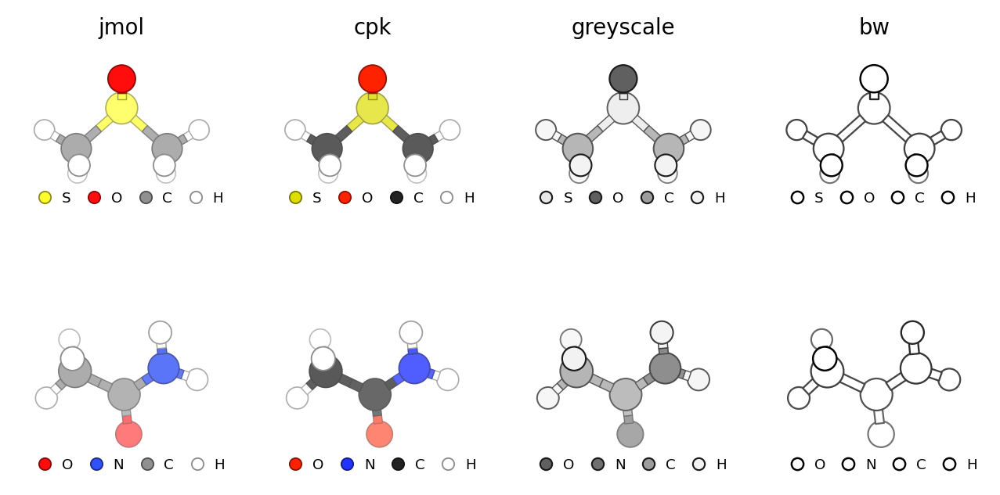
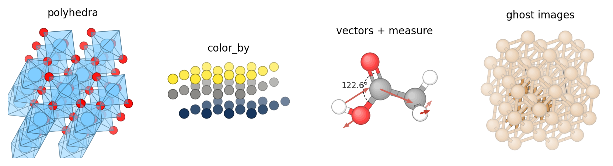
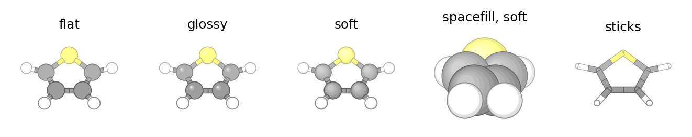
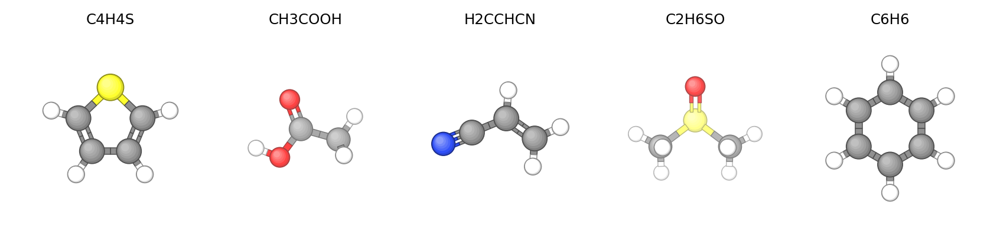
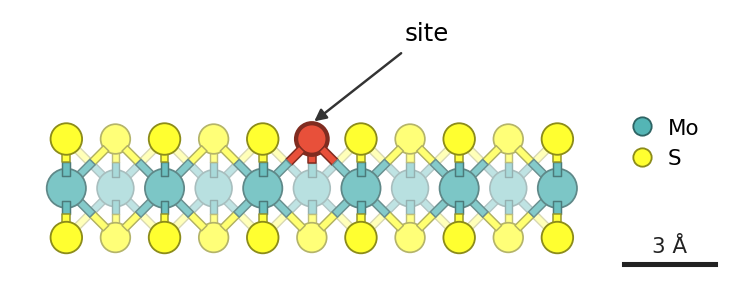

# inkatoms

Elegant drawings of atomic structures, made natively in matplotlib. A drawing
is one depth-sorted vector artist, so it stays sharp in a PDF, can be edited in
Illustrator or Inkscape, and sits in a figure panel next to your plots with the
same fonts, axes and annotations.




**What it does**

- **Depth cueing**: atoms further back fade towards the page and shrink, so a
  flat projection still reads in 3D; highlighted atoms are never faded.
- **Correct overlaps**: atoms, half-bonds, polyhedra, rings, arrows and cell
  edges are depth-sorted together.
- **Everything a structure figure needs**: bond orders, colour by any per-atom
  value with a colorbar, per-atom arrows, coordination polyhedra, rings,
  hydrogen bonds, breaking/forming bonds, labels, measured distances and
  angles, lattice planes, cell vectors, ghost images, vacancies, fixed atoms,
  partial occupancies, volumetric slices.
- **Figure tools**: structures inset on data plots, trajectory strips with
  shared framing, animations, fixed inches-per-Å scale, journal column sizes,
  an interactive atom picker, a command-line tool.
- **Standard looks**: Jmol, CPK, VESTA, colour-blind-safe, greyscale,
  black-and-white and dark presets; flat, glossy or soft shading; ball-and-stick,
  space-filling or sticks.
- **Reads** ASE `Atoms`, pymatgen `Structure`/`Molecule`, RDKit molecules (and
  SMILES), MDAnalysis universes, or plain arrays. Only numpy, scipy and
  matplotlib are required.

Documentation and gallery: https://joelcrewe.github.io/InkAtoms

## Install

```bash
pip install inkatoms            # once released on PyPI
pip install "inkatoms[all]"     # plus ASE, pymatgen, RDKit, MDAnalysis
```

From a clone: `pip install -e ".[dev]"`.

## Quick start

```python
import matplotlib.pyplot as plt
from ase.build import molecule
import inkatoms as ia

fig, ax = plt.subplots(figsize=(3, 3))
art = ia.draw(ax, molecule("CH3COOH"), view="auto", bond_orders=True, shading="soft")
ia.legend(ax, art, loc="upper left")
ia.measure(art, [1, 0, 2])            # the O=C-O angle
fig.savefig("acetic_acid.pdf")
```

`draw` returns a `StructureArtist` that knows where every atom landed, so
ordinary matplotlib annotation works: `ax.annotate("site", xy=art.xy(12), ...)`.

## Looks

| preset        | |
|---------------|-|
| `jmol`        | Jmol element colours (default) |
| `cpk`         | classic CPK model colours |
| `vesta`       | VESTA element colours |
| `colourblind` | common elements on the Okabe-Ito palette |
| `greyscale`   | luminance-matched greys, dark outlines |
| `bw`          | black-and-white line art |
| `dark`        | Jmol colours on a dark background |

Depth cueing is on by default; `depth_cue=False` draws every atom at full colour
and size, and `fade_distance=6` fades over a fixed 6 Å instead of the whole depth
of the drawing (so small and large structures fade alike).

`layers={"S": 0, "Mo": 1, "H": 2}` draws whole elements above others (atoms in a
layer still sort and fade by depth), which keeps a network or adsorbates visible
in a dense slice.

Any style field can be changed in the call:

```python
ia.draw(ax, atoms, style="cpk", shading="glossy", depth_fade=0.4,
        colors={"Mo": "#54b5b5"}, edge_colors={"H": "#1a1a1a"}, bond_color="#777777",
        occlusion=0.8)
```



## Views

`view` is the structure direction pointing out of the page: `"z"` top, `"-y"`
side, `"auto"` the widest face. `rotate="20x,-30y"` tilts about the page axes;
`perspective=12` places a camera 12 Å from the centre.

## Chemistry

```python
ia.draw(ax, atoms, bond_orders=True)                       # double/triple bonds from lengths
ia.draw(ax, ia.from_smiles("Cn1cnc2c1c(=O)n(C)c(=O)n2C"),  # exact bond orders from RDKit
        bond_orders=True)
ia.draw(ax, atoms, contacts="hbonds", rings={"aromatic": "auto"},
        bond_styles={(4, 9): "breaking", (9, 12): "forming"})
```



## Materials

```python
ia.draw(ax, structure, polyhedra={"centers": "Ti"}, boundary=True, cell=True,
        planes=[(1, 1, 1)], cell_vectors=True, style="vesta")
art = ia.draw(ax, slab, color_by="z", cmap="cividis")      # or "coordination", "charges", an array
ia.colorbar(art, label="height (Å)")
ia.draw(ax, atoms, vectors="forces", vector_scale=2.0)     # any (N, 3) array

data, atoms = ia.read_cube("density.cube")
art = ia.draw(ax, atoms, view="z")
ia.density_slice(art, data, atoms.cell[:])                 # the slice through the page plane
```

## Selecting what to draw

```python
from inkatoms import select

big = select.tile(slab, (3, 3, 1))                  # bonds across the cell stay whole
cut = select.slab(big, axis="y", half_width=4, at=[site_id], keep=[site_id])
cut = select.drop_unbonded(cut)
ia.draw(ax, cut, view="-y", highlight={site_id: "#e8503a"}, highlight_front=True)
```

Atom ids survive every selection, so `highlight`, `art.xy(id)` and `keep`
always refer to the original atoms. Read your own ids with
`ia.as_structure(atoms, ids="uid")`. Also: `select.around`, `select.box`,
`select.images` (ghosts), `select.boundary`, `select.make_whole`.



## Figures

```python
ia.panels(axes, frames, view="-y", highlight=[42])       # one view, fade and framing for a strip
ia.inset(ax, atoms, (x, energy), size=0.25)              # a structure at a point of a plot
anim = ia.animate(frames); anim.save("traj.gif", writer="pillow")
ia.draw(ax, atoms, scale=0.2)                            # 1 Å = 0.2 in, the same in every figure
fig = plt.figure(figsize=ia.figsize("rsc", "double", 0.4))
ia.picker(art)                                           # hover to see ids (interactive backends)
ia.draw(ax, atoms, editable=True)                        # one SVG element per atom ("atom-12")
```

## Fonts on macOS

matplotlib before 3.11 reads only the regular face of macOS's Helvetica
collection, so `fontweight="bold"` silently prints regular. `ia.use_collection_faces()`
registers the other faces (from a local cache) and bold works again.

## Trajectories: events, trails and comparisons

```python
frames = ase.io.read("md.xyz", ":")                 # atoms carry a persistent "uid" array

# bonds that form and break (a change counts once it lasts min_frames), grouped into reactions
rx = ia.find_reactions(frames, cutoffs={"Mo-S": 2.85, "S-H": 1.8}, only=[2491], min_frames=5)[0]
print(rx)         # 196.60 ps  S–H forms (atom added) ... 215.40 ps  Mo–S breaks ...
ia.event_strip(axes, frames, rx, view="y", up="-z", window=(16, 19.5))   # a slab through the site,
                                     # the reacting atoms in role colours, one labelled panel per step
ia.plot_neighbours(ax, frames, 2491, events=rx.events)    # its Mo / H neighbour counts over time

# where atoms went: style="arrow" (smoothed route), "ghosts" (copies at earlier times) or "line"
ia.draw(ax, frames[-1], trails={"frames": frames, "ids": [2491], "style": "arrow"})

# how B differs from A: atoms matched (by id, distance, or distance + environment),
# aligned, B drawn over faint ghosts of A with arrows, coloured by how far atoms moved
art, cmp = ia.draw_comparison(ax, start, relaxed, arrow_scale=8, arrow_max=2)
print(cmp)        # RMSD and the atoms that moved most
ia.compare(a, b, ids_a="uid", ids_b="uid")          # choose the ids, pin pairs you know with
ia.compare(a, b, known={12: 40, 13: 41})            # known=, or give the whole mapping with pairs=

# follow atoms with no (or unreliable) ids: frame-to-frame optimal assignment, optionally
# with a model learned from frames that do have ids
model = ia.fit_link_model(labelled_frames)          # logistic regression, one model per element
tracked = ia.link(unlabelled_frames, method="learned", model=model, max_jump=1.5)
```

Atoms inserted or removed (grand-canonical runs) are reported as "atom added" /
"removed". `inkatoms.ml` adds local-environment descriptors (a built-in radial
fingerprint, or SOAP via `pip install "inkatoms[ml]"`), `environment_states` (k-means
over all frames) and `environment_events`, which find environment changes without
any bond cutoff; on the MoS3 etching trajectory they pick out the same moments as
the bond events.

## Command line

```bash
inkatoms structure.cif -o structure.pdf --view z --polyhedra --cell --style vesta
inkatoms traj.xyz -i 120 --bond-orders --labels symbol --color-by coordination
```

## Performance

One `draw` of a 10,000-atom slab takes about 2 s on a laptop (`benchmarks/bench.py`).
Very large drawings are rasterised automatically inside the vector file
(`rasterized="auto"`) so PDFs stay small; pass `rasterized=False` to keep pure vectors.

## Related projects

- ASE's `plot_atoms` draws atoms as depth-ordered circles on an axes.
- pymatviz has 2D structure plots for pymatgen structures.
- AtomsPlotter draws ASE structures to standalone images, with bond orders, a
  Lewis mode and a 3D mode.
- VESTA and OVITO are full viewers and renderers; inkatoms is for the
  matplotlib figure itself.

## Citing

See `CITATION.cff`. A JOSS paper draft is in `paper/`.

## Development

```bash
pip install -e ".[dev,docs]"
pytest --mpl                                  # tests including image comparison
python -m sphinx -b html docs docs/_build/html
python examples/readme_images.py              # regenerate the README images
```

See `CONTRIBUTING.md` and `CHANGELOG.md`.
