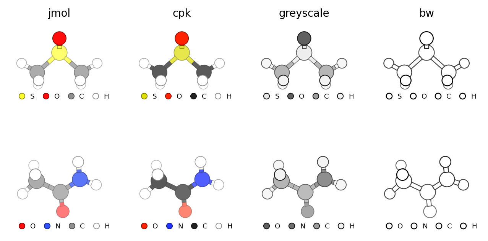

inkatoms
========

Elegant, vector drawings of atomic structures, made natively in matplotlib so
they sit in figure panels next to your plots, stay sharp in PDFs and can be
edited in Illustrator or Inkscape.

.. code-block:: python

   import matplotlib.pyplot as plt
   from ase.build import molecule
   import inkatoms as ia

   fig, ax = plt.subplots()
   art = ia.draw(ax, molecule("C2H6SO"), view="auto", bond_orders=True, shading="soft")
   ia.legend(ax, art)

.. toctree::
   :maxdepth: 2

   quickstart
   auto_examples/index
   api

Source: https://github.com/JoelCrewe/InkAtoms
